# Ismail Rhoulam

PhD student in Marketing Science at Mohammed V University in Rabat (LARMODADD, FSJES Souissi).

My research is on **experiment-calibrated marketing measurement**. Marketing mix models are cheap to run but easy to fool; randomized experiments are reliable but narrow and expensive. I work on combining the two, so that budget decisions rest on causal evidence.

<picture>
  <source media="(prefers-color-scheme: dark)" srcset="./assets/figure1-dark.svg">
  
</picture>

<i>Figure 1 (illustrative). A lift test pulls an uncertain model estimate of channel ROI toward the experimental result.</i>

## Research questions

**Transportability.** A lift test ran in one market, in one quarter. When does its result hold for the market and period where the budget is actually being decided, and how should it be adjusted when it doesn't?

**Adaptive experimentation.** How can an experiment shift its allocation as data comes in, so it answers the question the decision depends on sooner and at lower cost?

**Risk-aware budget allocation.** Effect estimates come with uncertainty. How should a budget account for the downside instead of optimizing expected return alone?

<picture>
  <source media="(prefers-color-scheme: dark)" srcset="./assets/figure2-dark.svg">
  
</picture>

<i>Figure 2 (illustrative). (a) A selection diagram: S marks what differs between the source and target market. (b) Traffic moving toward the best arm over rounds. (c) The lower tail of returns that a risk-aware allocation guards against.</i>

## Education

Master's degree, Marketing Management Digital et Commerce Électronique, FSJES Souissi, Mohammed V University in Rabat, 2024–2026 
Bachelor's degree, Marketing Management Digital et Commerce Électronique, FSJES Souissi, Mohammed V University in Rabat, 2023–2024

## Research stack

| Area | Tools |
|---|---|
| Core | Python, R, SQL, LaTeX, Git, Docker |
| Data science | NumPy, pandas, SciPy, Matplotlib, Plotly |
| Machine learning | scikit-learn, MLflow |
| Deep learning | PyTorch, TensorFlow, Keras |
| Bayesian modeling | PyMC, Stan, NumPyro |
| Marketing mix modeling | Meridian, PyMC-Marketing, Robyn |
| Causal inference | DoWhy, EconML, causaleffect |
| Experimentation | GeoLift, Ax, BoTorch |
| Optimization | CVXPY |

## Code

Code for papers and ongoing projects will be posted here as it becomes public.

## Contact

[ismail.rhoulam@um5r.ac.ma](mailto:ismail.rhoulam@um5r.ac.ma) · [ORCID](https://orcid.org/0009-0007-1800-237X) · [Google Scholar](https://scholar.google.com/citations?hl=en&user=BsJc3JQAAAAJ) · [LinkedIn](https://www.linkedin.com/in/ismail-rhoulam/)
